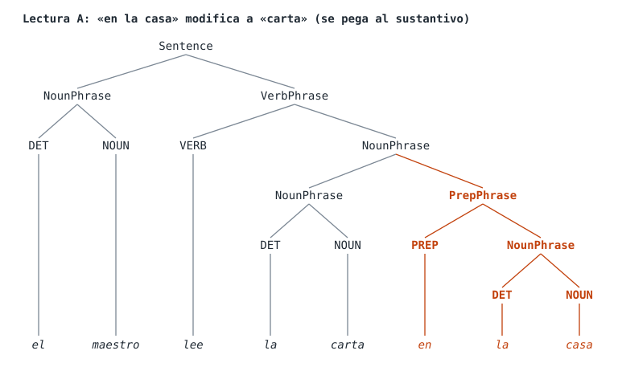
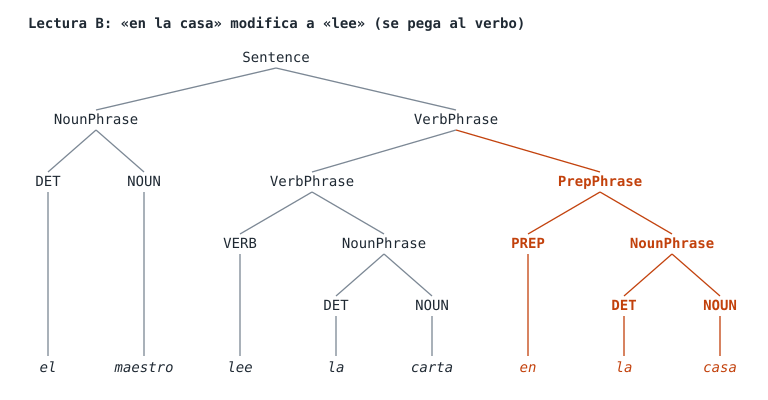

# Gramática del español y límites de las gramáticas libres de contexto

Sección del informe a cargo de P1. Cubre O1 y la actividad A1, y el análisis formal de dónde falla una gramática libre de contexto (CFG) con el español.

## 1. Marco teórico

**Jerarquía de Chomsky.** Chomsky clasificó las gramáticas formales en cuatro tipos según el poder de sus reglas: regulares (tipo 3), libres de contexto (tipo 2), sensibles al contexto (tipo 1) y sin restricciones (tipo 0). Cada tipo incluye a los de número mayor: todo lenguaje regular es libre de contexto, y así sucesivamente. En este proyecto, el lexer de la Fase 1 y el de la Fase 2 trabajan con tipo 3 (expresiones regulares y búsqueda en el lexicón) y los parsers con tipo 2. El detalle de la jerarquía y su relación con C++ está en `docs/informe/p4_analisis_formal.md`, sección 1; aquí solo se usa lo que hace falta para el español.

**Gramática libre de contexto.** Una CFG tiene reglas `A → α`, donde `A` es un solo no terminal y `α` una cadena de símbolos. «Libre de contexto» quiere decir que `A` se reescribe igual sin importar qué haya a su alrededor. Una derivación se dibuja como un árbol de análisis (*parse tree*), y ese árbol es la salida de nuestro parser.

**Ambigüedad.** Una gramática es ambigua si una misma oración tiene dos o más árboles. La ambigüedad es una propiedad de la gramática, pero a veces viene del lenguaje: si la oración tiene dos significados, cualquier gramática que los distinga le dará dos árboles.

**LL(1) y descenso recursivo.** Una gramática es LL(1) si el parser puede decidir qué producción usar mirando solo el siguiente token, sin retroceder. Se comprueba con los conjuntos FIRST y FOLLOW y la tabla `M[A, a]`: la gramática es LL(1) exactamente cuando ninguna celda de la tabla tiene más de una producción. Nuestro verificador (`verifier/`, Fase 1) calcula todo esto. Con una gramática LL(1) el parser se escribe con un método por no terminal y sin backtracking, que es lo que hacemos en las dos fases.

## 2. Diseño de la gramática

El subconjunto cubre una oración con sujeto, verbo, objeto opcional, un adverbio opcional después del objeto y frases preposicionales al final. El sujeto y el objeto siempre llevan determinante, y el punto final es opcional. El vocabulario son 98 palabras sin ambigüedad de categoría, con presente y pretérito (la gramática no distingue el tiempo: es un rasgo del lexicón).

Hay tres gramáticas en `grammars/`, y cada una responde una pregunta distinta. Los tamaños los mide el verificador:

| Archivo | Para qué sirve | Producciones | No terminales | Terminales | ¿LL(1)? |
|---|---|---|---|---|---|
| `es.gram` | La gramática del parser, con concordancia | 35 | 22 | 17 | Sí, salvo `M[NpTail, PREP]`, aceptado |
| `es_base.gram` | La misma estructura sin concordancia | 18 | 12 | 7 | Sí, salvo el mismo conflicto |
| `es_natural.gram` | Cómo se escribiría sin pensar en LL(1) | 9 | 4 | 6 | No: 2 conflictos sin aceptar |

**La concordancia va dentro de la gramática.** No hay analizador semántico. En lugar de comprobar después que «los» y «niño» concuerdan, la gramática tiene una copia de cada regla por género y número (MS, FS, MP, FP) y una versión singular y otra plural para sujeto y verbo:

```
NpMS -> DET_MS NOUN_MS AdjListMS NpTail
NpFP -> DET_FP NOUN_FP AdjListFP NpTail
Clause -> NpSing VpSing | NpPlur VpPlur
```

Con esto, `los niño come` no tiene árbol: no existe ninguna derivación que mezcle `DET_MP` con `NOUN_MS`.

**Un solo conflicto, y es deliberado.** En `es.gram`, `NpTail -> PrepPhrase NpTail | ε` choca con sí mismo: `PREP` puede empezar una frase preposicional del sustantivo, pero también puede seguir a `NpTail` (porque después de un objeto viene `PpList`, que empieza con `PREP`). Es un conflicto FIRST/FOLLOW, el mismo tipo que el *else* colgante de la gramática de C++. El parser resuelve el conflicto eligiendo siempre `PrepPhrase NpTail`: la frase se pega al sustantivo más cercano. La sección 4 muestra qué consecuencias tiene.

**Comprobaciones.** Los números de la tabla, el conflicto, que `es_natural.gram` no sea LL(1) y que `grammars/es.bnf` sea exactamente la notación de clase de `es.gram` se revisan en `tests/test_es_grammars.py`. Esa prueba también comprueba que los terminales de `es.gram` sean exactamente los tipos de token del lexicón.

## 3. La concordancia hace crecer la gramática

Pasar de `es_base.gram` a `es.gram` lleva las producciones de 18 a 35 y los no terminales de 12 a 22, solo con género y número. Para ver la tendencia y no solo dos puntos, `experiments/grammar_growth.py` construye gramáticas con la estructura de `es.gram` y más rasgos de concordancia, y las mide con el mismo verificador. El primer rasgo es el número, el segundo el género, y del tercero en adelante son hipotéticos (otro rasgo que también tuviera que concordar). Las filas con rasgos son gramáticas generadas y leídas de vuelta por el verificador; la de 2 rasgos tiene exactamente el tamaño de `es.gram` (35, 22 y 17), lo que valida el generador.

| Gramática | Rasgos | Clases de sintagma nominal | Producciones | No terminales | Terminales | Producciones respecto a `es_base.gram` |
|---|---|---|---|---|---|---|
| Sin concordancia (`es_base.gram`) | 0 | 1 | 18 | 12 | 7 | ×1.0 |
| Número | 1 | 2 | 27 | 18 | 11 | ×1.5 |
| Género y número (`es.gram`) | 2 | 4 | 35 | 22 | 17 | ×1.9 |
| 3 rasgos | 3 | 8 | 51 | 30 | 29 | ×2.8 |
| 4 rasgos | 4 | 16 | 83 | 46 | 53 | ×4.6 |
| 5 rasgos | 5 | 32 | 147 | 78 | 101 | ×8.2 |

Con *k* clases de sintagma nominal y *n* grupos de número, la gramática tiene `4k + 3n + 13` producciones. Cada clase aporta 4: su sintagma nominal (1), su lista de adjetivos (2) y su entrada en `NpSing` o `NpPlur` (1); la fórmula coincide con todas las filas medidas. Como *k* se duplica con cada rasgo binario nuevo, lo que se añade a la gramática también se duplica: +8, +16, +32, +64 producciones. Todas las gramáticas generadas siguen siendo LL(1) salvo el mismo conflicto.

Conclusión: con rasgos de valores finitos, la concordancia **sí cabe en una CFG**: sigue siendo de tipo 2. Lo que se pierde es el tamaño y, con él, la facilidad de mantener la gramática y la claridad de los árboles. Agregar persona o tiempo multiplicaría las clases otra vez.

## 4. El español es ambiguo

La oración `el maestro lee la carta en la casa` tiene dos lecturas: ¿lee en la casa, o la carta que está en la casa? Con `es_natural.gram`, que usa recursión izquierda sin preocuparse por LL(1), `nltk.ChartParser` encuentra los dos árboles (`experiments/ambiguity_trees.py`):

| Lectura A: la frase se pega al sustantivo | Lectura B: la frase se pega al verbo |
|---|---|
| `NounPhrase -> NounPhrase PrepPhrase` | `VerbPhrase -> VerbPhrase PrepPhrase` |
|  |  |

Las dos lecturas usan las mismas palabras en el mismo orden. Lo único que cambia es de qué cuelga la rama `PrepPhrase` (en naranja en los dibujos).

**Qué hace nuestra gramática.** `es.gram` no es ambigua por descuido: el conflicto `M[NpTail, PREP]` es esta misma ambigüedad. Medido con `nltk`, `es.gram` y `es_base.gram`, leídas como CFG puras, también dan los dos árboles para esta oración. El parser obtiene uno solo porque en `np_tail` decide siempre por el sustantivo y nunca prueba la otra rama. Por eso, en las oraciones ambiguas del set, el parser siempre dirá «sustantivo»: la lectura B existe en la gramática, pero el método descendente no la explora. Esto es lo que mide la Tarea C frente a spaCy y el LLM.

**Por qué no se arregla reescribiendo la gramática.** La recursión izquierda (`NounPhrase -> NounPhrase ADJ`) y los prefijos comunes sí son defectos de escritura: se eliminan transformando la gramática, y así `es_natural.gram` se vuelve `es_base.gram` sin cambiar el lenguaje. La ambigüedad de la frase preposicional no: viene del lenguaje, porque la oración realmente tiene dos significados. Mientras la gramática acepte ambas lecturas, tendrá dos árboles; para tener uno, hay que **elegir** (como hacemos) o usar información que una CFG no tiene (el significado de las palabras).

## 5. Dependencias cruzadas: lo que no cabe en ninguna CFG

El fenómeno que sí excede a las CFG es el de las construcciones con «respectivamente»: «Juan, Ana y Luis están cansado, cansada y cansado, respectivamente». El primer sujeto se empareja con el primer adjetivo, el segundo con el segundo, y así sucesivamente. Las dependencias **se cruzan**, a diferencia de las anidadas (a b b a), que una pila sí maneja. Esta oración no se programa: se demuestra aquí.

**Formalización.** Sea `a` un sujeto masculino y `b` uno femenino, y sean `A` y `B` los adjetivos que concuerdan con ellos (`h(a) = A`, `h(b) = B`). Sea *L* el conjunto de oraciones con *n* sujetos seguidos de *n* adjetivos en los que el *i*-ésimo adjetivo concuerda en género con el *i*-ésimo sujeto:

*L* = { w · h(w) | w ∈ {a, b}⁺ }.

**Teorema.** *L* no es libre de contexto.

**Demostración.**

1. Los lenguajes libres de contexto son cerrados bajo intersección con un lenguaje regular. Sea *R* = a⁺b⁺A⁺B⁺, que es regular. Una cadena w·h(w) está en *R* exactamente cuando w = aⁱbʲ con i, j ≥ 1: si en w algún `b` aparece antes que un `a`, w·h(w) tiene un `b` antes de un `a`, y no está en *R*. Entonces:

   *L* ∩ *R* = *L₂* = { aⁱbʲAⁱBʲ | i, j ≥ 1 }.

   Si *L* fuera libre de contexto, *L₂* también lo sería.

2. Supongamos que *L₂* es libre de contexto y sea *p* su longitud de bombeo. Tomemos z = aᵖbᵖAᵖBᵖ ∈ *L₂* y una descomposición cualquiera z = uvwxy con |vwx| ≤ p y |vx| ≥ 1.

3. La subcadena vwx no puede contener un `a` y un `A`: entre el último `a` y el primer `A` hay p letras `b`, así que cualquier tramo que contenga ambas tendría al menos p + 2 símbolos. Por la misma razón, no puede contener un `b` y un `B` (entre ellos hay p letras `A`). Es decir, de cada pareja (`a`, `A`) y (`b`, `B`), vx tiene a lo sumo una letra.

4. Como |vx| ≥ 1, vx tiene alguna letra *c* de {a, b, A, B}, y su pareja no está en vx. Al bombear con i = 2, la cantidad de *c* aumenta y la de su pareja se queda igual. Pero toda cadena de *L₂* tiene tantas `a` como `A` y tantas `b` como `B`. Luego uv²wx²y ∉ *L₂* (y si además se rompió la forma a⁺b⁺A⁺B⁺, tampoco está).

5. Esto contradice el lema de bombeo. Luego *L₂* no es libre de contexto, y por el paso 1, *L* tampoco. ∎

**Comprobación por fuerza bruta.** `tests/test_es_grammars.py` verifica, para p = 1 a 5, que **ninguna** descomposición de z = aᵖbᵖAᵖBᵖ sobrevive al bombeo con i = 2, y que la intersección con *R* es *L₂* para todas las palabras w de hasta 8 letras. No es una demostración (solo prueba valores pequeños de p), pero confirma el análisis de casos de los pasos 3 y 4. Como control, la prueba también muestra que el lenguaje con dependencias **anidadas** { aⁱbʲBʲAⁱ } sí sobrevive a un bombeo, así que la comprobación no rechaza todo lo que ve.

**Alcance del argumento.** Es una idealización: supone un número **ilimitado** de pares. Para un *n* máximo fijo el lenguaje es finito, y todo lenguaje finito es regular, así que existe una gramática (grande) que lo cubre: hay 2ⁿ combinaciones de género que la gramática debe distinguir. La conclusión correcta es: *para cada n hace falta un conjunto distinto de reglas, y no existe una sola CFG que sirva para todos los n a la vez*. Es el mismo tipo de argumento que Shieber (1985) usó con las dependencias cruzadas del alemán suizo para sostener que el lenguaje natural no es libre de contexto en general. Aquí lo aplicamos a una construcción del español bajo el supuesto de que se admiten listas de cualquier longitud.

**Relación con el set de prueba.** Las oraciones con «respectivamente» aparecen en el nivel 3. El parser las rechaza antes, porque la palabra no está en el lexicón y la coma no es un signo válido. Esa razón es práctica; la de fondo es la de esta sección: aunque ampliáramos el vocabulario, ninguna gramática de tipo 2 las cubriría todas.

## 6. Qué cabe en una CFG y qué dejamos fuera

Resumen de los fenómenos del nivel 3 del set. La columna «¿Cabe en una CFG?» es un análisis cualitativo, no una medición: todo lo que se puede describir con reglas de reescritura sin comparar cantidades ilimitadas cabe. Nuestra gramática deja fuera la mayoría por alcance, no por imposibilidad.

| Fenómeno | Ejemplo | ¿Cabe en una CFG? | Por qué no está en `es.gram` |
|---|---|---|---|
| Subordinadas | `el perro que corre duerme` | Sí, con recursión (una oración dentro de un sintagma nominal) | Decisión de alcance; `que` no está en el lexicón |
| Coordinación | `el niño y la niña comen` | Sí, aunque añade ambigüedad y la concordancia se complica (singular + singular = plural) | Decisión de alcance |
| Clíticos | `lo come` | Sí, con más clases de concordancia | Sin pronombres en el vocabulario |
| Contracciones | `del niño` | Es un problema léxico, no gramatical | Sin contracciones en el vocabulario |
| Otro orden de palabras | `el niño rápidamente come` | Sí, con más producciones | El adverbio va solo después del objeto |
| Concordancia | `los niño come` | Sí, pero la gramática crece (sección 3) | Está dentro de la gramática |
| Ambigüedad | `la carta en la casa` | Sí, pero con dos árboles (sección 4) | Se elige una lectura |
| `respectivamente` | ver sección 5 | **No** (con *n* ilimitado) | Ninguna gramática de tipo 2 lo resuelve |

## 7. Cómo se reproduce

```
uv run python -m verifier grammars/es.gram
uv run python -m verifier grammars/es_base.gram
uv run python -m verifier grammars/es_natural.gram
uv run python -m verifier grammars/es.gram --class-notation -o grammars/es.bnf
uv run python -m experiments.ambiguity_trees     # los dos árboles y sus dibujos
uv run python -m experiments.grammar_growth      # la tabla de la sección 3
uv run pytest tests/test_es_grammars.py
```

## Referencias

- Hopcroft, J., Motwani, R. y Ullman, J. *Introducción a la teoría de autómatas, lenguajes y computación*. Capítulos 5 (gramáticas y ambigüedad) y 7 (lema de bombeo y cerraduras de los libres de contexto).
- Aho, A., Lam, M., Sethi, R. y Ullman, J. *Compiladores: principios, técnicas y herramientas*. Sección 4.4 (análisis sintáctico descendente, FIRST, FOLLOW y gramáticas LL(1)).
- Chomsky, N. (1956). *Three models for the description of language*. IRE Transactions on Information Theory.
- Shieber, S. (1985). *Evidence against the context-freeness of natural language*. Linguistics and Philosophy, 8.
