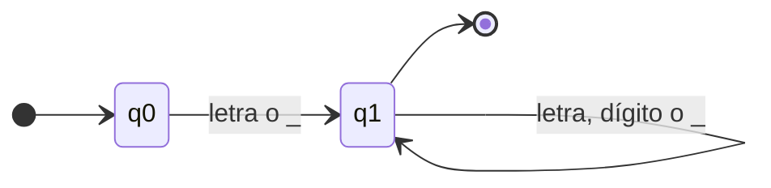
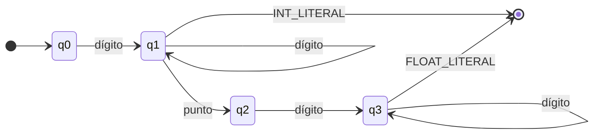

# Especificación de los tokens

Este documento define formalmente los tokens del subconjunto de C++ (actividad A1). Las expresiones regulares de abajo son las mismas que usa `minicpp/lexer.py`, copiadas tal cual; `tests/test_lexer.py` revisa que este archivo y el código no se separen.

## Alfabeto y notación

El alfabeto $\Sigma$ son los caracteres ASCII. Fuera de las cadenas, de los caracteres y de los comentarios no se acepta nada más: una `ñ` o una `á` sueltas en el código son un error léxico.

Las expresiones usan la sintaxis del módulo `re` de Python, que es la notación de clase con algunas abreviaturas:

| Notación | Significado | En la notación de clase |
|---|---|---|
| `[0-9]` | un carácter del rango | $0 \mid 1 \mid \dots \mid 9$ |
| `[^"\n]` | cualquier carácter menos los de la lista | $\Sigma - \{\texttt{"}, \texttt{\\n}\}$ |
| `r+` | una o más veces | $r\,r^*$ |
| `r?` | cero o una vez | $r \mid \varepsilon$ |
| `\+`, `\*`, `\(` | el carácter literal, no el operador | |
| `\t`, `\n`, `\r` | tabulación, salto de línea, retorno de carro | |

Cada tipo de token $T$ tiene una expresión $r_T$, y el conjunto de lexemas de ese token es el lenguaje regular $L(r_T) \subseteq \Sigma^*$.

## Expresiones regulares

### Tokens

```
INCLUDE          #[ \t]*include[ \t]*<(iostream|string)>
FLOAT_LITERAL    [0-9]+\.[0-9]+
INT_LITERAL      [0-9]+
STRING_LITERAL   "([^"\\\n]|\\[nt\\"\'])*"
CHAR_LITERAL     '([^'\\\n]|\\[nt\\\"'])'
ID               [A-Za-z_][A-Za-z0-9_]*
PLUS             \+
MINUS            -
STAR             \*
SLASH            /
PERCENT          %
INCREMENT        \+\+
DECREMENT        --
ASSIGN           =
PLUS_ASSIGN      \+=
MINUS_ASSIGN     -=
STAR_ASSIGN      \*=
SLASH_ASSIGN     /=
PERCENT_ASSIGN   %=
EQUAL            ==
NOT_EQUAL        !=
LESS             <
GREATER          >
LESS_EQUAL       <=
GREATER_EQUAL    >=
AND              &&
OR               \|\|
NOT              !
SHIFT_LEFT       <<
SHIFT_RIGHT      >>
LPAREN           \(
RPAREN           \)
LBRACE           \{
RBRACE           \}
SEMICOLON        ;
COMMA            ,
COLON            :
```

En `STRING_LITERAL` y `CHAR_LITERAL`, la parte `\\[nt\\"']` son los escapes permitidos: `\n`, `\t`, `\\`, `\"` y `\'`. Ninguna de las dos expresiones acepta un salto de línea, así que una cadena no puede ocupar varias líneas.

### Palabras reservadas

No tienen una expresión propia. El lexer las lee con la expresión de `ID` y después busca el lexema en la tabla `KEYWORDS` de `minicpp/tokens.py`:

`using`, `namespace`, `std`, `int`, `float`, `double`, `char`, `bool`, `string`, `void`, `if`, `else`, `while`, `do`, `for`, `switch`, `case`, `default`, `break`, `continue`, `return`, `cin`, `cout`, `endl`, `true` y `false`.

Cada una tiene como tipo la misma palabra en mayúsculas (`while` da `WHILE`). Lo que no está en la tabla se queda como `ID`, así que `While`, `iff` o `entero` son identificadores. Hacerlo así evita escribir 26 expresiones más, y en el autómata de identificadores no hay que agregar un camino aparte para cada palabra.

### Texto que se ignora

```
WHITESPACE       [ \t\r\n]+
LINE_COMMENT     //[^\n]*
BLOCK_COMMENT    /\*([^*]|\*+[^*/])*\*+/
```

El lexer reconoce este texto igual que un token, pero no lo agrega a la lista. La expresión de `BLOCK_COMMENT` es la forma clásica de describir un comentario `/* */` sin operadores especiales: adentro puede haber asteriscos, siempre que no vayan seguidos de `/`. Por eso `/* a /* b */` es un solo comentario y termina en el primer `*/`.

### Errores

```
BAD_NUMBER       [0-9][0-9A-Za-z_.]*
BAD_STRING       "([^"\\\n]|\\.)*"?
BAD_CHAR         '([^'\\\n]|\\.)*'?
BAD_COMMENT      /\*([^*]|\*+[^*/])*\**\Z
BAD_DIRECTIVE    #[ \t]*[A-Za-z_]*[ \t]*(<[A-Za-z_]*>?|"[^"\n]*"?)?
```

Estas expresiones describen texto que se parece a un token pero está mal escrito. Compiten con las demás (ver la siguiente sección), y cuando una gana, el lexer se detiene con un error léxico. `\Z` significa "fin del archivo": `BAD_COMMENT` solo coincide con un `/*` que llega al final sin encontrar su `*/`.

| Entrada | Expresión que gana | Mensaje |
|---|---|---|
| `x = 5 @ 3;` | ninguna coincide con `@` | carácter no reconocido '@' |
| `3.14f`, `5.`, `1.2.3`, `3x` | `BAD_NUMBER` | número mal formado '3.14f' |
| `"Hola` | `BAD_STRING` | cadena sin cerrar |
| `"a\qb"` | `BAD_STRING` | secuencia de escape no válida '\q' |
| `''` | `BAD_CHAR` | literal de carácter vacío '' |
| `'ab'` | `BAD_CHAR` | literal de carácter con más de un carácter |
| `'a` | `BAD_CHAR` | literal de carácter sin cerrar |
| `/* sin cerrar` | `BAD_COMMENT` | comentario sin cerrar |
| `#include <vector>` | `BAD_DIRECTIVE` | biblioteca no soportada '<vector>' |
| `#define N 10` | `BAD_DIRECTIVE` | directiva de preprocesador no soportada '#define' |

Cada error se reporta con la línea y la columna donde empieza el lexema, que es donde hay que corregir. La excepción es el escape inválido: ahí la columna es la de la barra invertida.

## Cómo elige el lexer

En cada posición del código, el lexer prueba todas las expresiones (tokens, texto ignorado y errores) y se queda con la que coincide con más caracteres. Es la regla de la coincidencia más larga, la misma que usan `lex` y `flex`. Si dos expresiones coinciden con la misma cantidad, gana la que aparece primero en las tablas de arriba.

Algunos casos:

| Código | Candidatas | Resultado |
|---|---|---|
| `<<=` | `LESS` (1), `SHIFT_LEFT` (2) | `SHIFT_LEFT`, y después `ASSIGN` |
| `a+++b` | en `+++`: `PLUS` (1), `INCREMENT` (2) | `ID INCREMENT PLUS ID` |
| `> >` | `GREATER` (1); el espacio corta | dos `GREATER`, no `SHIFT_RIGHT` |
| `while` | `ID` (5) | `ID`, y la tabla de reservadas lo cambia a `WHILE` |
| `3.14` | `FLOAT_LITERAL` (4), `BAD_NUMBER` (4) | empate, gana `FLOAT_LITERAL` porque va primero |
| `3.14f` | `FLOAT_LITERAL` (4), `BAD_NUMBER` (5) | gana `BAD_NUMBER`: error léxico |

Los dos últimos casos muestran para qué sirven las expresiones de error. Un número bien escrito siempre empata con `BAD_NUMBER`, y en el empate gana el token válido. Solo cuando hay letras o puntos pegados, `BAD_NUMBER` se lleva más caracteres y gana.

Con esta regla el orden de los operadores en la tabla no importa, porque ningún operador empata con otro: `+` y `++` coinciden con distinta cantidad de caracteres.

## Autómatas finitos

Toda expresión regular tiene un autómata finito determinista (AFD) que reconoce el mismo lenguaje. Estos son los AFD de los dos tokens más interesantes, con $M = (Q, \Sigma, \delta, q_0, F)$. Las transiciones que no aparecen van a un estado de error implícito.

### Identificadores

$$
M_{ID} = (\{q_0, q_1\},\ \Sigma,\ \delta,\ q_0,\ \{q_1\})
$$

Con $L$ = letras y `_`, y $D$ = dígitos:

| $\delta$ | $L$ | $D$ |
|---|---|---|
| $q_0$ | $q_1$ | |
| $q_1$ | $q_1$ | $q_1$ |



Un identificador no puede empezar con dígito porque desde $q_0$ no hay transición con $D$. Por eso `3x` nunca llega a ser `ID`: lo toma el autómata de números.

### Números enteros y reales

`INT_LITERAL` y `FLOAT_LITERAL` comparten el principio, así que se reconocen con un solo AFD que tiene dos estados de aceptación:

$$
M_{NUM} = (\{q_0, q_1, q_2, q_3\},\ \Sigma,\ \delta,\ q_0,\ \{q_1, q_3\})
$$

| $\delta$ | $D$ | `.` |
|---|---|---|
| $q_0$ | $q_1$ | |
| $q_1$ | $q_1$ | $q_2$ |
| $q_2$ | $q_3$ | |
| $q_3$ | $q_3$ | |



Si el autómata termina en $q_1$, el token es `INT_LITERAL`; si termina en $q_3$, es `FLOAT_LITERAL`. $q_2$ no es de aceptación, y por eso `5.` no es un número válido: después del punto tiene que venir al menos un dígito. Tampoco hay transición desde $q_0$ con `.`, así que `.5` no empieza un número.

## Relación con la jerarquía de Chomsky

Cada $L(r_T)$ es un lenguaje regular, tipo 3 en la jerarquía de Chomsky, y por eso el lexer no necesita una pila: le basta saber en qué estado del autómata va. La estructura anidada del programa (bloques dentro de bloques, paréntesis balanceados) ya no es regular, y esa parte le toca al parser, que trabaja con una gramática libre de contexto (tipo 2).
